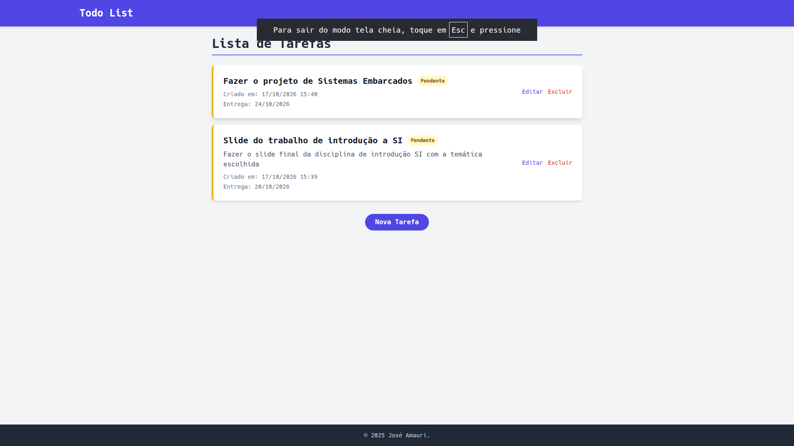
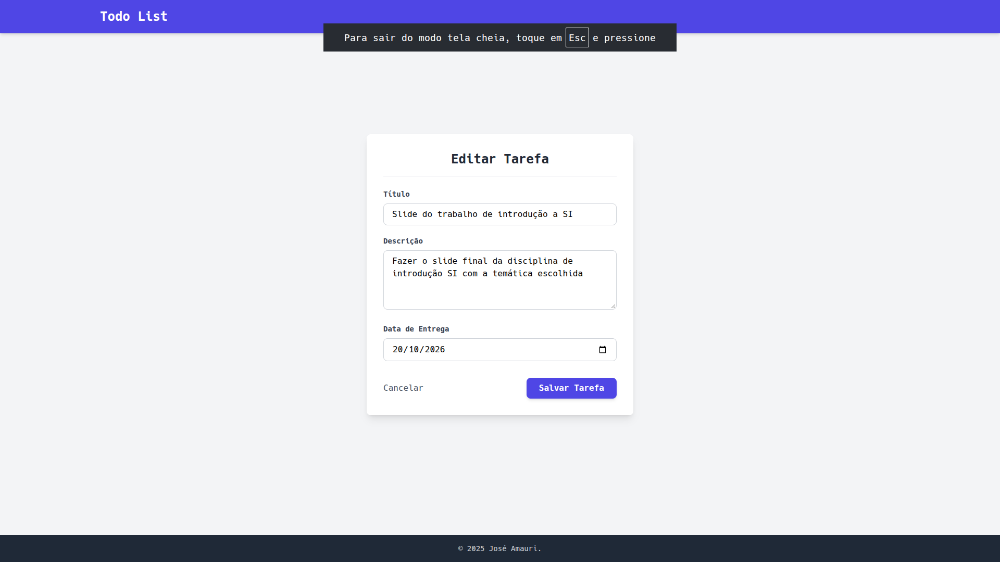

# Todo List

Aplicação web de lista de tarefas feita com **Django**: criar, listar, editar e excluir tarefas, com status de concluída e data de entrega.




## Funcionalidades

- **Criar tarefa** com título, descrição e data de entrega
- **Listar tarefas**, das mais recentes para as mais antigas, com indicação de pendente/concluída
- **Editar tarefa** (a marcação como concluída é feita pelo painel administrativo)
- **Excluir tarefa**, com página de confirmação antes de apagar
- Validação dos formulários feita pelo Django (`ModelForm`)
- Painel administrativo do Django em `/admin/`

## Tecnologias

- Python 3.12+
- Django 6.0
- SQLite
- Tailwind CSS (via CDN)

## Como rodar

```bash
git clone https://github.com/JoseAmauriOP/todo-list.git
cd todo-list

python -m venv venv
source venv/bin/activate        # Windows: venv\Scripts\activate

pip install -r requirements.txt
python manage.py migrate
python manage.py runserver
```

Acesse `http://127.0.0.1:8000`.

## Como o projeto está organizado

```
todo-list/
├── config/          # configurações do projeto Django (settings, urls)
├── tasks/           # app de tarefas
│   ├── models.py    # modelo Task
│   ├── forms.py     # TaskForm (ModelForm)
│   ├── views.py     # views de listar, criar, editar e excluir
│   ├── urls.py
│   └── templates/tasks/
└── templates/       # template base
```

| Rota | O que faz |
|---|---|
| `/` | Lista as tarefas |
| `/create/` | Formulário de nova tarefa |
| `/edit/<id>/` | Edita uma tarefa |
| `/delete/<id>/` | Confirma e exclui uma tarefa |

## O que aprendi

- Montar um CRUD completo no padrão MVT do Django (model, view, template)
- Usar `ModelForm` para gerar e validar formulários a partir do modelo
- Reaproveitar o mesmo formulário para criar e editar, passando `instance`
- Tratar registros inexistentes com `get_object_or_404`
- Exigir `POST` para ações destrutivas, como excluir

## Próximos passos

- [ ] Testes automatizados das views e do formulário
- [ ] Filtro por tarefas pendentes e concluídas
- [ ] Login, para cada usuário ver só as próprias tarefas

---

Desenvolvido por [José Amauri Patrício](https://www.linkedin.com/in/amauri-patricio-5a121435b)
